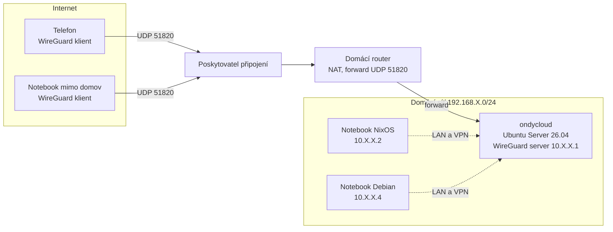

# Topologie sítě

## Cíl
Přehled, jak spolu zařízení komunikují a jak se z internetu dostanu na server. Adresy jsou záměrně zobecněné.

## Diagram

## Popis
- **Hvězdicová VPN:** server je střed, klienti (notebooky, telefon) se k němu připojují přes WireGuard (`10.X.X.0/24`). Detaily v [wireguard.md](wireguard.md).
- **Jediný vstup zvenku:** UDP 51820 na routeru, přesměrovaný na server. Viz [port-forwarding.md](port-forwarding.md).
- **Služby jen přes VPN:** SSH, Gitea a Nextcloud jsou dostupné z rozhraní `wg0`, z veřejné sítě ne. Viz [hardening.md](../server/hardening.md).
- **Doma:** notebooky se k serveru připojují i přes veřejnou adresu routeru (hairpin NAT), takže jdou stejnou cestou jako klient zvenku.
- **Záloha přístupu:** Tailscale zatím zůstává jako druhá cesta na server, než ho odstraním.

## Toky

| Odkud | Kam | Protokol | Poznámka |
|---|---|---|---|
| Klient mimo domov | router (veřejná adresa) | UDP 51820 | jediný otevřený port |
| Router | server | UDP 51820 | port forward |
| Klient ve VPN | server | TCP 22, 80, 443, 3000 | jen přes `wg0` |
| Internet | server (ostatní porty) | cokoli jiného | zahozeno (router, ufw) |
